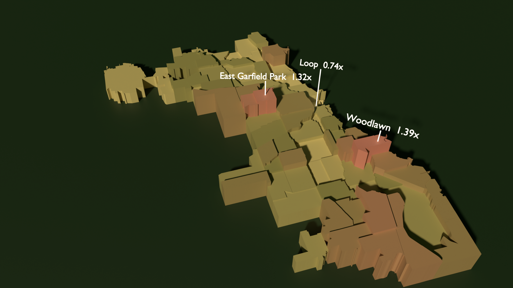

# Chicago City Scorecard

How well is Chicago serving its residents? Built from 311 requests, census income data, city clinic locations and federally funded community health centers.

- **Service tracker:** requests, backlog and close times for the last 90 days, with the headline finding up top
- **Service ratings:** each service ranked on speed and backlog (computed from 311 records, not votes)
- **Neighborhood scorecard:** all 77 community areas graded A to F, sortable and searchable
- **Health access map:** distance from each neighborhood to the nearest city clinic, plus 152 community health centers with hours, phone and directions
- **Who waits longer:** the same type of 311 request takes longer to close in the poorest neighborhoods than in the richest

Each view has its own link, for example `#who-waits-longer`.

## Run it

```bash
npm install
npm run dev
```

To see the production build (what you would demo or deploy):

```bash
npm run build
npm run preview
```

## Data

| Source | Used for |
|---|---|
| Chicago Data Portal: 311 service requests | tracker, ratings, scorecard, wait times |
| Chicago Data Portal: community area boundaries | map shapes, neighborhood names |
| Chicago Data Portal: ACS 5-year by community area | population, share of households under $25k |
| Chicago Data Portal: CDPH clinic locations | city clinics (24) |
| HRSA: health center service delivery sites | community health centers |

The app shows saved data first, then swaps in live portal data when it arrives (the portal can take a minute; the app gives up after 90 seconds and keeps the saved data). Refresh the saved data before a demo:

```bash
npm run snapshot
```

## How "who waits longer" is measured

Each neighborhood's close times are compared with the city average for its own mix of request types, so an area isn't penalized for filing slower kinds of requests. Same-day services are left out. The richest and poorest fifths are the areas with the smallest and largest share of households under $25k. Per-service gaps only count neighborhoods with 30 or more closed requests.

Limits: it shows that income and wait time go together, not why. It only counts tickets the city closed. Grades are relative, so some area always gets an F.

## 3D wait-time skyline (Blender)



[Watch the 10-second spinning version](blender/skyline_loop.mp4)

Each neighborhood is raised by its wait index: gold is faster than the city average for the same requests, olive is average, rose is slower. Built from the same data and `equity()` math as the app.

```bash
node blender/export.js
blender -b -P blender/skyline.py              # still -> blender/skyline.png
blender -b -P blender/skyline.py -- anim      # 10 s spinning loop -> blender/skyline_loop.mp4
```

With the Microsoft Store install, run `blender-launcher.exe` in place of `blender`.

## Tests

```bash
npm test
```

Covers the scoring math, the wait-time comparison, and the health center data cleanup.
